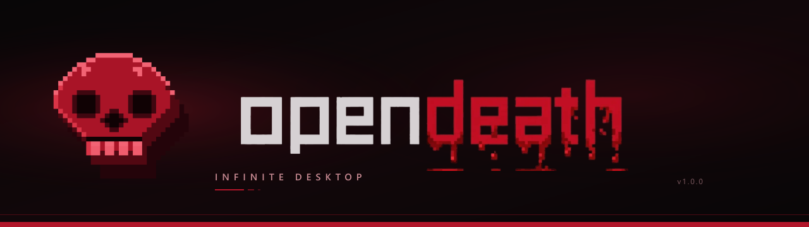
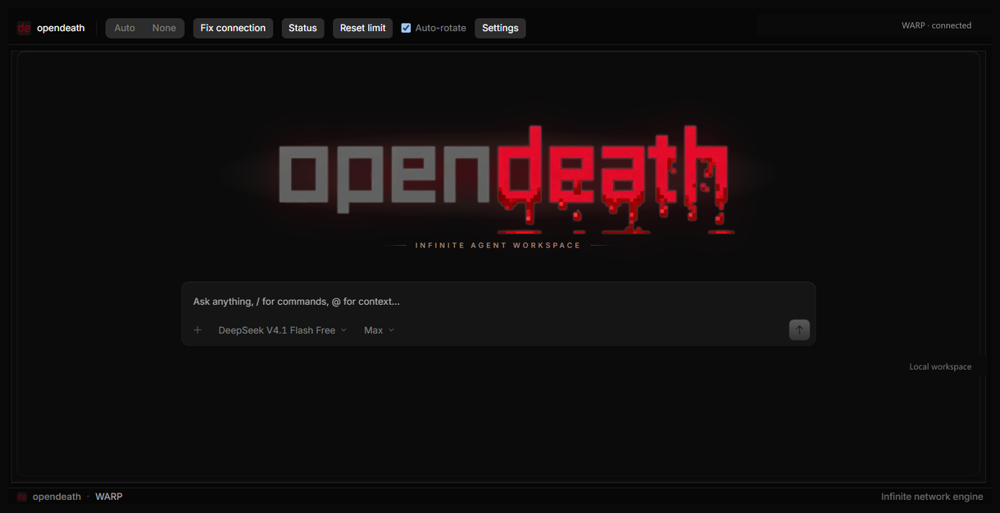
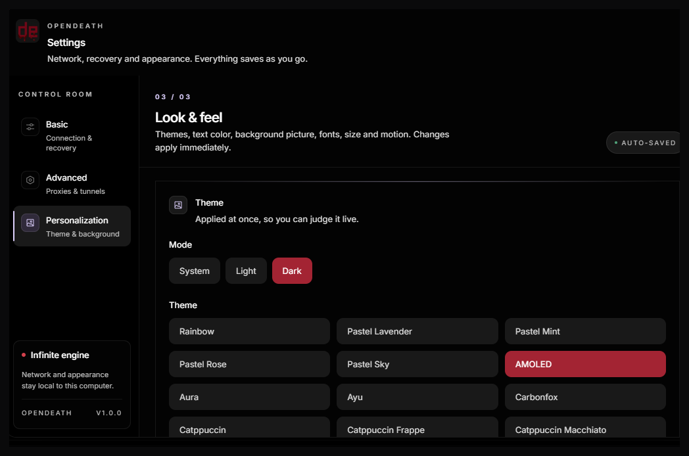

<p align="center">
  
</p>

<p align="center">
  <a href="https://open.death.cl/download.html"></a>
  
  
  <a href="https://github.com/saintedKyle/opendeath-src"></a>
</p>

# OpenDeath

**A desktop AI workspace with the Infinite network deck built in.**

OpenDeath is an independent desktop application for Windows and Linux, built on the
OpenCode engine. Its identity, command deck, status bar, settings experience, installer,
and relaunch-resume engine are original work. The sessions, tools, agents, providers,
and sign-in flow you already use keep working.

It is **not** a plugin, a theme, or a wrapper around the OpenCode window. OpenDeath ships
as its own executable with its own application data and its own bundled engine.

> **OpenDeath does not launch, replace, or modify your OpenCode Desktop installation.**
> On Windows the setup wizard checks for OpenCode Desktop because the two apps share the
> local sign-in store. It installs and launches `opendeath.exe` only.

---

## Why OpenDeath

| | |
|---|---|
| **One-click network rotation** | Move the exit IP without leaving the chat. Auto, WARP, HTTP Proxy, SOCKS5, Route64, Mullvad, Windscribe, or Direct. |
| **WARP that keeps working** | 1.0.4 rotates the tunnel key instead of registering a new device, so Cloudflare's registration throttle no longer blocks **New IP**. |
| **Keep the conversation going** | When a provider free limit appears, OpenDeath rotates and sends `continue` to the waiting chats. |
| **Survives a restart** | Waiting chats are written to disk and resumed after the app relaunches. |
| **Explains itself** | **Help** shows the last network error with the fixes and copyable commands for that exact failure. |
| **Windows and Linux** | Guided setup and portable build on Windows. AppImage, deb, rpm, AUR and a one-command installer on Linux. |
| **A desktop, not a demo** | Native tabs, diffs, terminal, built-in browser, dictation, themes, rainbow mode, and a full settings surface. |

---

## Screens



| Settings | Personalization |
|---|---|
|  |  |

---

## Features

### Infinite network deck

- Eight connection modes: **Auto, WARP, HTTP Proxy, SOCKS5, Route64, Mullvad, Windscribe, None**
- **Reset limit** - archive the session, change the IP, restore the session, then retry
- **New IP** - rotates the WARP tunnel key first, then redials, and only registers when needed
- **Auto-rotate** - 1 to 50 attempts, with burned-IP memory for 24 hours
- **Fix connection** - diagnose and rebuild the selected route
- **Status** - current IP, route, and engine state
- **Help** - the last error, what causes it, and the command that fixes it
- **Continue after relaunch** - resumes waiting chats after the app restarts
- Parallel `continue` delivery to every waiting chat, with duplicate-send protection

### Workspace

- Sessions, tabs, project files, diffs, and a built-in terminal
- Built-in browser and page inspection
- Voice dictation
- Light, dark, and system themes
- Custom background, rainbow accents, and text color
- **Settings - Control room** with Basic, Advanced, and Personalization tabs

### Distribution

- Portable single executable, guided setup wizard, or Linux packages
- Per-user install on Windows, no administrator account required
- Optional dependency checkboxes for WARP, Windscribe, Mullvad, and WireGuard
- Optional `opendeath` terminal CLI, installed by the Windows setup or the Linux installer
- Desktop and Start menu shortcuts that point to **OpenDeath**, never OpenCode
- Clean uninstaller that leaves your chats and settings in place
- Installed builds self-update from the official feed

---

## Download

Grab the latest build from **[open.death.cl](https://open.death.cl/download.html)**.

| Asset | Best for | Notes |
|---|---|---|
| `OpenDeath-Setup-1.0.4.exe` | Most Windows users | Guided wizard, shortcuts, optional VPN and CLI installs, uninstaller |
| `OpenDeath-Portable-1.0.4.exe` | No install on Windows | Runs from any folder or USB drive |
| `OpenDeath-1.0.4-x86_64.AppImage` | Any Linux distribution | Single file, no installation |
| `OpenDeath-1.0.4-amd64.deb` | Debian, Ubuntu, Mint, Pop!_OS, Kali | Installs the app and desktop entry |
| `OpenDeath-1.0.4-x86_64.rpm` | Fedora, RHEL, Rocky, AlmaLinux, openSUSE | Installs the app and desktop entry |
| `opendeath-cli-1.0.4-linux-x64.tar.gz` | Linux terminal only | The `opendeath` engine without the desktop app |
| `install.sh` | One-command Linux install | Detects the distribution, verifies checksums, can add WARP |
| `SHA256SUMS.txt`, `SHA256SUMS-linux.txt` | Verification | Checksums for every release file |

### Verify your download

Windows:

```powershell
Get-FileHash .\OpenDeath-Setup-1.0.4.exe -Algorithm SHA256
```

Linux:

```sh
sha256sum -c SHA256SUMS-linux.txt
```

Compare the result with the matching checksum file from the same release.

---

## Install

### Windows

1. Run `OpenDeath-Setup-1.0.4.exe`.
2. On **Prerequisites**, the wizard checks for Cloudflare WARP and OpenCode Desktop.
   - WARP is the default route. Use **Install WARP now** if it is missing.
   - OpenCode Desktop shares the local sign-in store. If it is missing, install it from
     the official page and click **Check again**. Advanced users can continue without it.
3. On **Choose components**, tick any optional VPN clients you want, and tick
   **Command line (opendeath)** to get the terminal CLI on your user PATH.
4. Choose whether to create Desktop and Start menu shortcuts.
5. Install, then leave **Launch OpenDeath** checked on the final page.

The wizard installs to `%LOCALAPPDATA%\Programs\OpenDeath` and creates an uninstaller in
**Settings - Apps - Installed apps**.

### Portable Windows build

`OpenDeath-Portable-1.0.4.exe` needs no installation. Run it from any writable folder.
It extracts to a temporary directory at launch and keeps user data in
`%APPDATA%\dev.opendeath.desktop`. Portable builds do not self-update - replace the file.

### Linux, one command

```sh
curl -fsSL https://open.death.cl/downloads/install.sh | sh
```

The script reads `/etc/os-release`, picks the right package, verifies the SHA-256, and
installs the `opendeath` CLI as well. Add `--warp` to install Cloudflare WARP in the same
run:

```sh
curl -fsSL https://open.death.cl/downloads/install.sh | sh -s -- --warp
```

Detected families: Debian, Ubuntu, Mint, Pop!_OS, Kali, Fedora, RHEL, Rocky, AlmaLinux,
Nobara, Arch, CachyOS, Manjaro, EndeavourOS, Garuda, and openSUSE. Anything else gets the
AppImage. User-level install is used when `sudo` is unavailable.

Arch and CachyOS can also use the AUR package `opendeath-bin`; the PKGBUILD is in
`packaging/linux/PKGBUILD` of the source repository.

### Linux packages by hand

```sh
# Debian, Ubuntu, Mint, Pop!_OS, Kali
sudo apt install ./OpenDeath-1.0.4-amd64.deb

# Fedora, RHEL, Rocky, AlmaLinux
sudo dnf install ./OpenDeath-1.0.4-x86_64.rpm

# openSUSE
sudo zypper install ./OpenDeath-1.0.4-x86_64.rpm

# Any distribution, no install
chmod +x OpenDeath-1.0.4-x86_64.AppImage
./OpenDeath-1.0.4-x86_64.AppImage
```

The desktop binary is `opendeath-desktop`, so the terminal command `opendeath` belongs to
the CLI. Start the WARP service once after installing WARP on Linux:

```sh
sudo systemctl enable --now warp-svc
```

### Silent Windows install

```powershell
.\OpenDeath-Setup-1.0.4.exe /S
```

Optional components are not selected in silent mode. Add `/COMPONENTS` only if you need a
custom unattended configuration.

---

## First run

1. Open **Settings - Control room** and choose a connection mode.
2. Click **Fix connection** to validate the route.
3. Click **Status** to confirm the exit IP.
4. If something fails, click **Help** and follow the fix for the error shown.
5. Start a chat. The deck stays under the title bar while you work.

WARP and the other VPN modes require their client to be installed and signed in. The
installer can add WARP, Windscribe, Mullvad, and WireGuard from their official sources.

---

## How it works

OpenDeath starts its own local OpenCode service, loads the desktop interface from a local
bundle, and manages the network route that the service uses.

- The bundled engine lives in `resources/opencode-cli.exe` on Windows and
  `resources/opencode-cli` on Linux.
- The UI is loaded from `resources/app.asar` - there is no remote web app.
- The service listens on a loopback port chosen at startup. Nothing is exposed to the LAN.
- Provider requests still go to the providers you configure. OpenDeath adds no proxy of its own.

When a free limit is detected, the network layer rotates the exit, waits for the new route
to become healthy, and asks each waiting chat to continue. If the app closes with chats
still waiting, the list is saved and restored on the next launch.

**WARP rotation.** Cloudflare rate-limits new device registrations, which used to make
**New IP** fail for everyone behind a busy address. 1.0.4 runs `warp-cli tunnel rotate-keys`
first: a new local key makes Cloudflare hand out a new exit without a new registration.
A redial is next. Registration is attempted only once per ten minutes, and if Cloudflare
answers 429 the app pauses new registrations for 30 minutes without dropping the existing
WARP connection.

**Reset limit.** The session is archived, the IP is rotated, and the session is restored
before the app reconnects. If the rotation fails, the session is still put back.

---

## Installed file structure

The source is public at **[saintedKyle/opendeath-src](https://github.com/saintedKyle/opendeath-src)**.
This is the user-facing layout of the installed application, not the build tree:

```text
%LOCALAPPDATA%\Programs\OpenDeath\
  opendeath.exe                  Main application
  Uninstall OpenDeath.exe        Uninstaller
  bin\opendeath.cmd              Optional terminal CLI wrapper
  resources\
    app.asar                     Packaged application UI
    opencode-cli.exe             Bundled OpenCode engine
    opencode-cli.version         Engine build identifier
    icons\                       Application icons
  locales\                       Electron language packs
  *.dll, *.pak, *.bin            Electron runtime files
```

User data is separate from the installation and survives upgrades and uninstalls:

```text
%APPDATA%\dev.opendeath.desktop\
  infinite.json                  Connection and rotation settings
  infinite\pending.json          Chats waiting to resume
  logs\                          Local diagnostics
  ...                            Window, theme, and session preferences
```

On Linux the application files live under `/opt/opendeath` (or the AppImage mount) and
user data lives under `~/.config/dev.opendeath.desktop`.

---

## Updating

Installed Windows and Linux builds check for updates at launch and every ten minutes after
that. They download in the background and ask once to restart. The feed is
`https://open.death.cl/downloads/latest.yml`, which carries the Windows installer; Linux
packages are installed from the release page or the one-command installer.

Portable builds do not self-update. Replace the executable; user data is unchanged.

---

## Uninstall

Windows: **Settings - Apps - Installed apps - OpenDeath - Uninstall**, or run
`Uninstall OpenDeath.exe` from the install folder. The uninstaller also removes the
`opendeath` PATH entry it added.

Linux: use your package manager, for example `sudo apt remove opendeath` or
`sudo dnf remove opendeath`.

Uninstalling does **not** delete the user data folder, so your settings and waiting chats
remain available if you reinstall.

---

## Troubleshooting

| Problem | Fix |
|---|---|
| Windows SmartScreen warning | The build is not code-signed. Choose **More info - Run anyway**, or verify the SHA-256 first. |
| WARP will not register | Cloudflare limits new registrations per address. 1.0.4 does not need one to change the IP: **New IP** rotates the tunnel key. If a registration is really missing, wait 10-30 minutes, run `warp-cli --accept-tos registration new`, then click **Fix connection**. |
| Cloudflare is throttling registrations | Only new registrations are paused, for 30 minutes. The existing WARP connection and key rotation keep working. Use Proxy if you also need another country. |
| WARP does not answer on `127.0.0.1:40000` | Older clients have no local proxy. 1.0.4 notices and uses the WARP tunnel instead. On Linux run `sudo systemctl enable --now warp-svc`. |
| `warp-cli` not found on Linux | The app looks on PATH and in `/usr/bin`. Install WARP with the one-command installer plus `--warp`, or from Cloudflare, then start `warp-svc`. |
| Reset limit signed me out | Fixed in 1.0.4: the session is archived, the IP changes, and the session is restored before the app reconnects. Make sure WARP or Proxy works first. |
| Optional VPN did not install | Confirm `winget --version` works, then install the client from its official site. Network restrictions can block `winget`. |
| WARP / Windscribe / Mullvad mode is unavailable | Install the client, sign in, start it once, then restart OpenDeath. |
| App looks blank after an update | Close OpenDeath, delete `%APPDATA%\dev.opendeath.desktop\Cache`, and relaunch. |
| Need a clean reset | Close OpenDeath and rename `%APPDATA%\dev.opendeath.desktop` to `dev.opendeath.desktop.bak`. |

**Help** in the network deck shows the last error with the same fixes and copyable
commands. More detail: [`docs/TROUBLESHOOTING.md`](docs/TROUBLESHOOTING.md).

---

## Privacy and fair use

- OpenDeath adds **no telemetry, analytics, or usage reporting**.
- Network probes go to Cloudflare's trace endpoint and the selected provider only.
- VPN clients are separate products with their own privacy policies.
- Free proxies and SOCKS5 servers can observe traffic metadata. Use HTTPS providers.
- Rotating an IP to bypass a provider's free-tier limit may violate that provider's terms.
  You are responsible for how you use the app and for complying with the services you connect to.

---

## License and source

OpenDeath is **open source** under the MIT License. The application source, build scripts,
packaging, and release workflow live at
**[saintedKyle/opendeath-src](https://github.com/saintedKyle/opendeath-src)**.

- Original OpenDeath work: MIT, see [`LICENSE`](LICENSE).
- Third-party components: see [`THIRD-PARTY-NOTICES.md`](THIRD-PARTY-NOTICES.md).
- OpenDeath is not affiliated with OpenCode, Cloudflare, Windscribe, Mullvad, or
  WireGuard. All trademarks belong to their owners.

Tor is not part of this product. The bundled client and every Tor code path were removed
in 1.0.3.

---

## Credits

Built by **saintkyle**.

Thanks to the OpenCode project for the engine, and to Cloudflare, Windscribe, Mullvad,
and WireGuard for the network tools this app integrates with.
