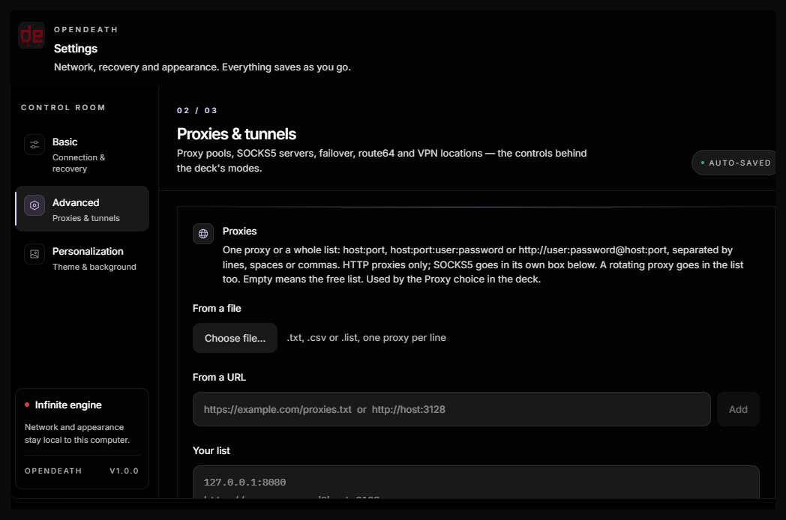

<p align="center">
  
</p>

<p align="center">
  <a href="https://github.com/saintedKyle/OpenDeath/releases/latest"></a>
  
  
  <a href="https://github.com/saintedKyle/opendeath-src"></a>
</p>

# OpenDeath

**A standalone desktop AI workspace with the Infinite network deck built in.**

OpenDeath is an independent Windows desktop application created from scratch for this
project. Its identity, command deck, status bar, settings experience, installer, and
relaunch-resume engine are original work. Under the hood it runs on the OpenCode engine,
so the sessions, tools, agents, providers, and sign-in flow you already use keep working.

It is **not** a plugin, a theme, or a wrapper around the OpenCode window. OpenDeath ships
as its own executable with its own application data and a bundled engine. The source is
public at <https://github.com/saintedKyle/opendeath-src>.

> **OpenDeath does not launch, replace, or modify your OpenCode Desktop installation.**
> The setup wizard verifies that OpenCode Desktop is present, then installs and launches
> `opendeath.exe` only.

---

## Why OpenDeath

| | |
|---|---|
| **One-click network rotation** | Move the exit IP without leaving the chat. Auto, WARP, Proxy, SOCKS5, Route64, Mullvad, Windscribe, or Direct. |
| **Keep the conversation going** | When a provider free limit appears, OpenDeath rotates and sends `continue` to the waiting chats. |
| **Survives a restart** | Waiting chats are written to disk and resumed after the app relaunches. |
| **Ready out of the box** | WARP is required and the wizard installs it before the app. Windscribe, Mullvad, and WireGuard can be added from their official sources. |
| **A desktop, not a demo** | Native tabs, diffs, terminal, built-in browser, dictation, themes, rainbow mode, and a full settings surface. |

---

## Screens


| Settings | Personalization |
|---|---|
|  |  |

---

## Features

### Infinite network deck
- Eight connection modes: **Auto, WARP, HTTP Proxy, SOCKS5, Route64, Mullvad, Windscribe, None**
- **Reset limit** — clear the current allowance and retry the last prompt
- **Auto-rotate** — 1 to 50 attempts, with burned-IP memory for 24 hours
- **Fix connection** — diagnose and rebuild the selected route
- **Status** — current IP, route, and engine state
- **Continue after relaunch** — resumes waiting chats after the app restarts
- Parallel `continue` delivery to every waiting chat, with duplicate-send protection

### Workspace
- Sessions, tabs, project files, diffs, and a built-in terminal
- Built-in browser and page inspection
- Voice dictation
- Light, dark, and system themes
- Custom background, rainbow accents, and text color
- Redesigned **Settings → Control room** with Basic, Advanced, and Personalization tabs

### Distribution
- Portable single executable, or a guided setup wizard
- Per-user install, no administrator account required
- Optional dependency checkboxes for WARP, Windscribe, Mullvad, and WireGuard
- Desktop and Start menu shortcuts that point to **OpenDeath**, never OpenCode
- Clean uninstaller that leaves your chats and settings in place

---

## Download

Grab the latest build from **[Releases](https://github.com/saintedKyle/OpenDeath/releases/latest)**.

| Asset | Best for | Notes |
|---|---|---|
| `OpenDeath-Setup-1.0.3.exe` | Most people | Guided wizard, shortcuts, optional VPN installs, uninstaller |
| `OpenDeath-Portable-1.0.3.exe` | No install | Runs from any folder or USB drive |
| `SHA256SUMS.txt` | Verification | SHA-256 checksums for both binaries |

### Verify your download

```powershell
Get-FileHash .\OpenDeath-Setup-1.0.3.exe -Algorithm SHA256
```

Compare the result with `SHA256SUMS.txt` from the same release.

---

## Requirements

| Requirement | Details |
|---|---|
| **Windows** | Windows 10 22H2 or Windows 11, 64-bit |
| **OpenCode Desktop** | **Required.** The wizard checks for it and offers the official download link if it is missing. [Download OpenCode](https://opencode.ai/desktop) |
| **Internet** | Required for model providers, sign-in, and optional dependency downloads |
| **Disk space** | About 1.3 GB installed |
| **winget** | Recommended. Used only when you tick optional VPN checkboxes. Windows 11 includes it; Windows 10 can install **App Installer** from the Microsoft Store. |

### Optional dependencies

You can select these in the setup wizard, or install them later from the vendor:

| Dependency | Purpose | Official source |
|---|---|---|
| **Cloudflare WARP** | WARP route and fast IP rotation | [1.1.1.1](https://1.1.1.1/) |
| **Windscribe** | Windscribe route and location changes | [windscribe.com](https://windscribe.com/) |
| **Mullvad VPN** | Mullvad route and location changes | [mullvad.net](https://mullvad.net/) |
| **WireGuard** | WireGuard tunnel profiles | [wireguard.com](https://www.wireguard.com/) |

OpenDeath never downloads these from a third-party mirror. The wizard calls `winget`,
which resolves each package to the publisher's official installer.

---

## Installation

1. Run `OpenDeath-Setup-1.0.3.exe`.
2. On the **Prerequisites** page, the wizard looks for OpenCode Desktop.
   - If it is found, continue.
   - If it is missing, click **Open download page**, install OpenCode Desktop, then click
     **Check again**.
3. On **Choose components**, tick any optional VPN clients you want. Leave them unchecked
   if you prefer to install them yourself.
4. Choose whether to create Desktop and Start menu shortcuts.
5. Install, then leave **Launch OpenDeath** checked on the final page.

The wizard installs to `%LOCALAPPDATA%\Programs\OpenDeath` and creates an uninstaller in
**Settings → Apps → Installed apps**.

### Portable build

`OpenDeath-Portable-1.0.3.exe` needs no installation. Run it from any writable folder.
It extracts to a temporary directory at launch and keeps user data in
`%APPDATA%\dev.opendeath.desktop`.

### Silent install

```powershell
.\OpenDeath-Setup-1.0.3.exe /S
```

Optional components are not selected in silent mode. Add `/COMPONENTS` only if you need a
custom unattended configuration.

---

## First run

1. Open **Settings → Control room** and choose a connection mode.
2. Click **Fix connection** to validate the route.
3. Click **Status** to confirm the exit IP.
4. Start a chat. The deck stays under the title bar while you work.

WARP is required and the wizard puts it in place. The other VPN modes require their client to be
installed and signed in.

---

## How it works

OpenDeath starts its own local OpenCode service, loads the desktop interface from a local
bundle, and manages the network route that the service uses.

- The bundled engine lives in `resources/opencode-cli.exe`.
- The UI is loaded from `resources/app.asar` — there is no remote web app.
- The service listens on a loopback port chosen at startup. Nothing is exposed to the LAN.
- Provider requests still go to the providers you configure. OpenDeath adds no proxy of its own.

When a free limit is detected, the network layer rotates the exit, waits for the new route
to become healthy, and asks each waiting chat to continue. If the app closes with chats
still waiting, the list is saved and restored on the next launch.

---

## Installed file structure

The source is public: <https://github.com/saintedKyle/opendeath-src>. This is the user-facing
layout of the installed application, not the build tree:

```text
%LOCALAPPDATA%\Programs\OpenDeath\
├─ opendeath.exe                  Main application
├─ Uninstall OpenDeath.exe        Uninstaller
├─ resources\
│  ├─ app.asar                    Packaged application UI
│  ├─ opencode-cli.exe            Bundled OpenCode engine
│  ├─ opencode-cli.version        Engine build identifier
│  └─ icons\                      Application icons
├─ locales\                       Electron language packs
├─ *.dll, *.pak, *.bin            Electron runtime files
└─ LICENSE.electron.txt           Electron license
```

User data is separate from the installation and survives upgrades and uninstalls:

```text
%APPDATA%\dev.opendeath.desktop\
├─ infinite.json                  Connection and rotation settings
├─ infinite\pending.json          Chats waiting to resume
├─ logs\                          Local diagnostics
└─ ...                            Window, theme, and session preferences
```

---

## Updating

OpenDeath has no background self-updater. Download the new release and run the setup
wizard over the existing installation. Your settings and chats are preserved.

To update the portable build, replace the old executable. User data is unchanged.

---

## Uninstall

Use **Settings → Apps → Installed apps → OpenDeath → Uninstall**, or run
`Uninstall OpenDeath.exe` from the install folder.

The uninstaller removes the application and shortcuts. It does **not** delete
`%APPDATA%\dev.opendeath.desktop`, so your settings and waiting chats remain available if
you reinstall.

---

## Troubleshooting

| Problem | Fix |
|---|---|
| Windows SmartScreen warning | The build is not code-signed. Choose **More info → Run anyway**, or verify the SHA-256 first. |
| “OpenCode Desktop was not found” | Install it from [opencode.ai/desktop](https://opencode.ai/desktop), then click **Check again** in the wizard. |
| Optional VPN did not install | Confirm `winget --version` works, then install the client from its official site. Network restrictions can block `winget`. |
| WARP / Windscribe / Mullvad mode is unavailable | Install the client, sign in, start it once, then restart OpenDeath. |
| WARP will not register | Cloudflare sometimes refuses new registrations. Run `warp-cli --accept-tos registration new`, then **Fix connection**. |
| App looks blank after an update | Close OpenDeath, delete `%APPDATA%\dev.opendeath.desktop\Cache`, and relaunch. |
| Need a clean reset | Close OpenDeath and rename `%APPDATA%\dev.opendeath.desktop` to `dev.opendeath.desktop.bak`. |

More detail: [`docs/TROUBLESHOOTING.md`](docs/TROUBLESHOOTING.md).

---

## Privacy and fair use

- OpenDeath adds **no telemetry, analytics, or usage reporting**.
- Network probes go to Cloudflare’s trace endpoint and the selected provider only.
- VPN clients are separate products with their own privacy policies.
- Free proxies can observe traffic metadata. Use HTTPS providers.
- Rotating an IP to bypass a provider’s free-tier limit may violate that provider’s terms.
  You are responsible for how you use the app and for complying with the services you connect to.

---

## License and source

OpenDeath is **closed-source**. This repository is the official distribution and
documentation hub; it contains no application source code.

- Original OpenDeath work: proprietary, see [`LICENSE`](LICENSE).
- Third-party components: see [`THIRD-PARTY-NOTICES.md`](THIRD-PARTY-NOTICES.md).
- OpenDeath is not affiliated with OpenCode, Cloudflare, Windscribe, Mullvad, WireGuard,
  All trademarks belong to their owners.

For GPL source-offer information, read the third-party notices.

---

## Credits

Built by **saintkyle**.

Thanks to the OpenCode project for the engine, and to Cloudflare,
Windscribe, Mullvad, and WireGuard teams for the network tools this app integrates with.
